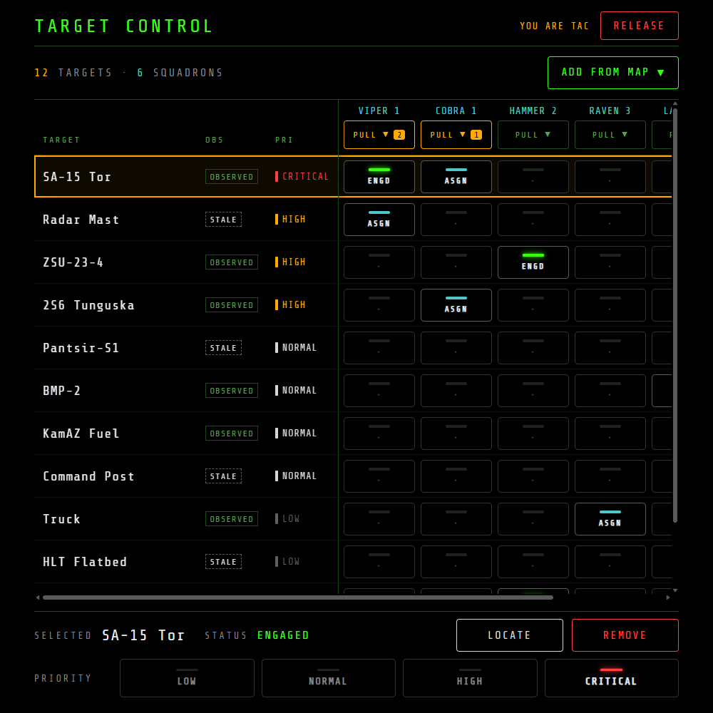
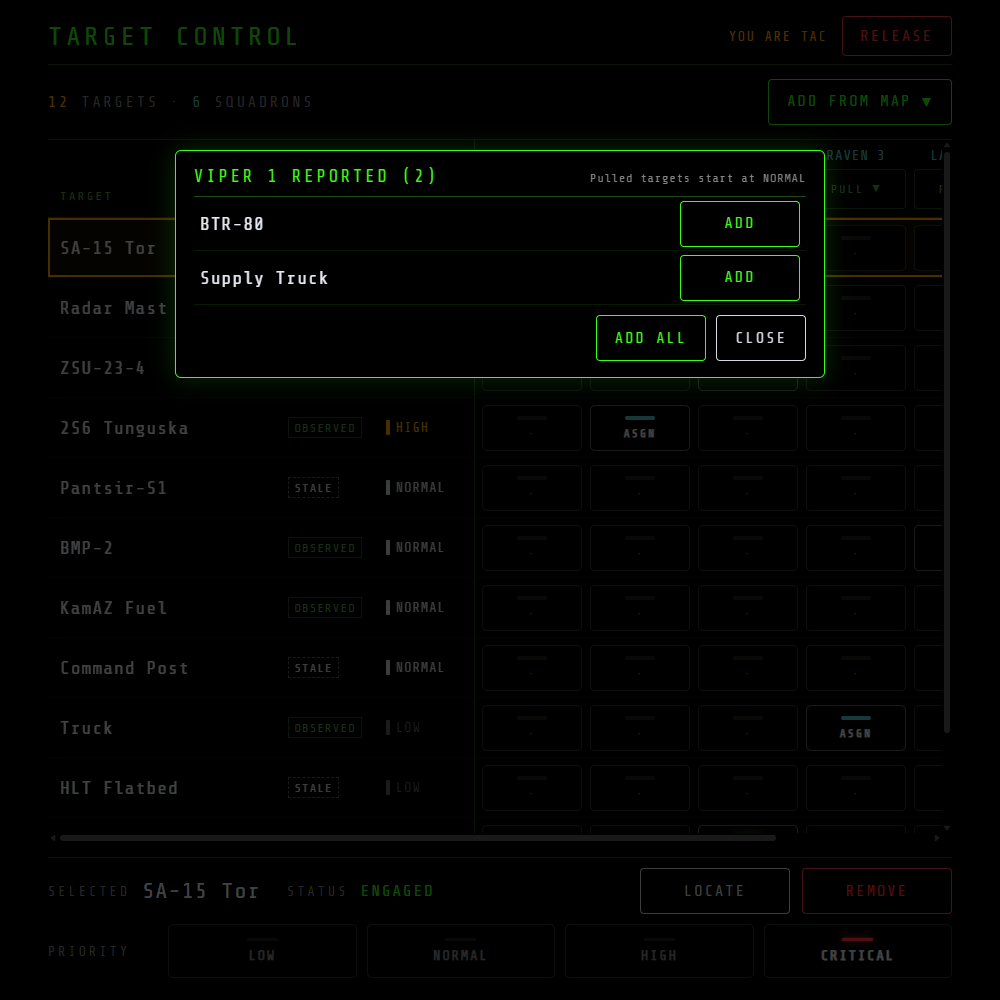
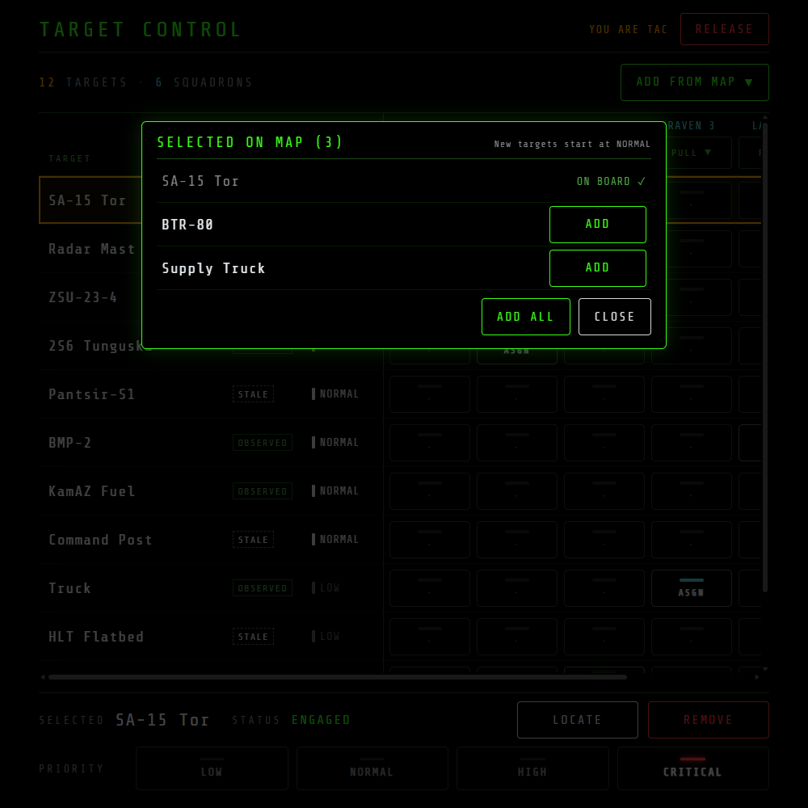
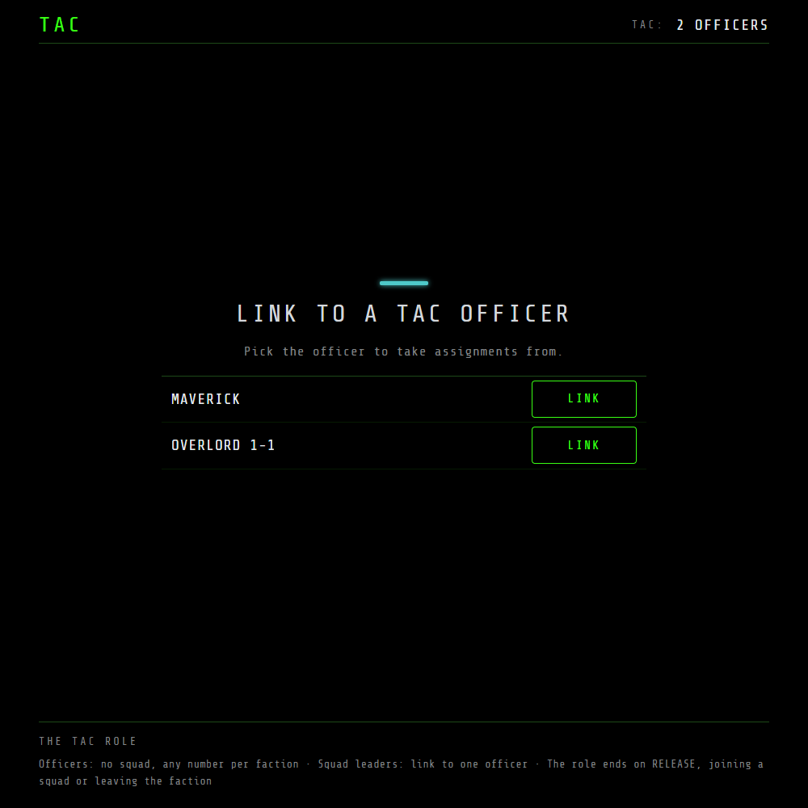
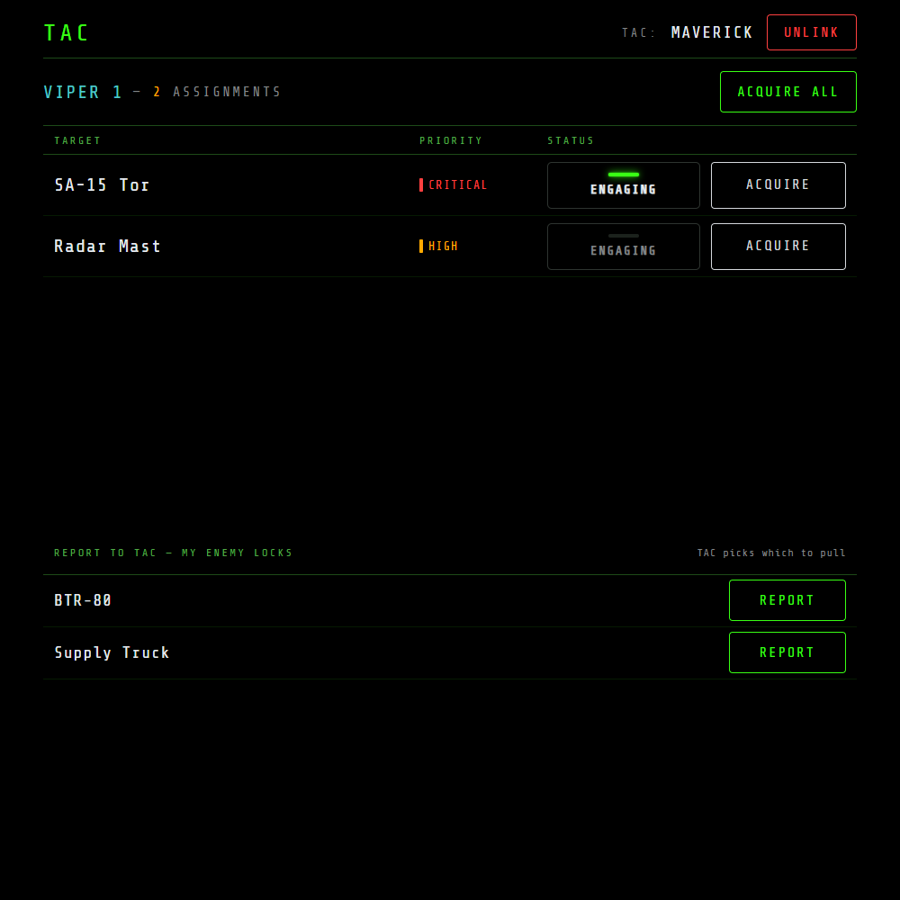

# NOXMFD Extension: TAC

[](https://github.com/roke77/NOXMFD)
[](https://github.com/roke77/NOXMFD-Extension-TAC/releases)
[](LICENSE)

Adds a **TAC** (Tactical Command) page to [NOXMFD](https://github.com/roke77/NOXMFD)'s browser MFD
for coordinating targets in multiplayer. A TAC officer collects targets on a board, sets their
priority and assigns them to squadrons; squad leaders see their assignments, select them in their
own targeting, mark the ones they're engaging, and report new targets back.

Built entirely through NOXMFD's public extension API (see
[`EXTENSIONS.md`](https://github.com/roke77/NOXMFD/blob/main/EXTENSIONS.md)), so it doesn't modify
NOXMFD. TAC is an experiment: if it proves useful, it may later become a native NOXMFD feature.

> [!IMPORTANT]
> **Install order:** BepInEx 5 → [NOXMFD](https://github.com/roke77/NOXMFD) (≥ 0.77.0) →
> **`NOXMFD.TacModule.dll`**. Every TAC officer and squad leader needs both installed.

---

## Table of contents

- [Features](#features)
- [Using the page](#using-the-page)
- [Installing](#installing)
- [Links](#links)
- [Building](#building)
- [Credits](#credits)

---

## Features

**For the TAC officer:**

- **Any player outside a squad can become an officer** with APPLY FOR TAC, and a faction can have
  several. RELEASE (a long press) gives the role up.
- **The squadron matrix:** one row per target, one column per squadron linked to you. Tap a cell to
  assign the target to that squadron (teal ASGN) or withdraw it; a cell turns green ENGD when the
  squadron is attacking it, and then needs a long press to withdraw.
- Each target shows OBSERVED or STALE from your faction's picture, and a priority from LOW to
  CRITICAL that you set at the bottom. **LOCATE** rings the target on MAP and centers MAP on it;
  **REMOVE** takes it off the board.
- **ADD FROM MAP** lists the enemies you've selected on NOXMFD's MAP page.
- **PULL** under a squadron lists the targets its leader has reported. The amber count shows how
  many are waiting; you pick which go on the board.
- Destroyed targets leave the board and every squadron's list on their own.



<p> </p>

**For squad leaders:**

- **Link to one officer** from the list of officers in your faction. You get only that officer's
  assignments; UNLINK (a long press) or link to another officer to switch.
- **Your squadron's assignments**, by priority. **ENGAGING** tells the officer you're attacking a
  target; **ACQUIRE** and **ACQUIRE ALL** select them in your own targeting, like a tap on MAP.
- **REPORT** sends one of your locked enemies to the officer's PULL for your squadron. Nothing about
  your locks reaches TAC unless you report it.

<p> </p>

Squad members and other players see the faction's officers. The page needs a mission running; with
no connection it shows NO SIGNAL.

---

## Using the page

1. **Officer:** stay out of any squad, open **EXT → TAC** in NOXMFD and press **APPLY FOR TAC**.
2. **Squad leaders:** open **EXT → TAC** and press **LINK** next to the officer. A column for your
   squadron appears on the officer's matrix.
3. **Officer:** select enemies on MAP and **ADD FROM MAP**, or open a squadron's **PULL** to add
   what its leader reported. Tap cells to assign, and set each target's priority.
4. **Squad leaders:** **ACQUIRE ALL** to select your assignments, press **ENGAGING** on the one
   you're attacking, and **REPORT** new targets you've locked.

---

## Installing

1. Install BepInEx 5 and [NOXMFD](https://github.com/roke77/NOXMFD) 0.77.0 or later.
2. Download `NOXMFD.TacModule_<version>.zip` from the
   [latest release](https://github.com/roke77/NOXMFD-Extension-TAC/releases/latest) and extract it
   into `BepInEx/plugins/`.
3. Launch the game. A **TAC** entry appears under NOXMFD's EXT nav.

---

## Links

- [Releases and changelog](https://github.com/roke77/NOXMFD-Extension-TAC/releases)
- [NOXMFD](https://github.com/roke77/NOXMFD): the browser MFD this page runs in
- [Design and roadmap](docs/tac-plan.md)
- [Two-player test](docs/two-player-test.md): the match checklist a release passes

---

## Building

Requires a local Nuclear Option install with BepInEx 5 and NOXMFD. If the game isn't at the default
Steam path, create a gitignored `GameDir.props` next to the `.csproj`:

```xml
<Project><PropertyGroup>
  <GameDir>D:\SteamLibrary\steamapps\common\Nuclear Option</GameDir>
</PropertyGroup></Project>
```

```bash
dotnet build TacModule.csproj -c Release
```

The build copies `NOXMFD.TacModule.dll` into `$(GameDir)\BepInEx\plugins\`. Run the tests with
`dotnet test tools/tests`.

To check the page without the game, run `python tools/preview.py 8793` and open
`http://localhost:8793/`. It reads NOXMFD's shared assets from a sibling `../NOXMFD` checkout (or a
path given as the second argument); `/scenario?role=<role>&s=<state>` switches the mock, as listed
in the script's header. With the preview running, `python tools/shot.py 8793` retakes the README
screenshots.

---

## Credits

- [NOXMFD](https://github.com/roke77/NOXMFD) by roke77.
